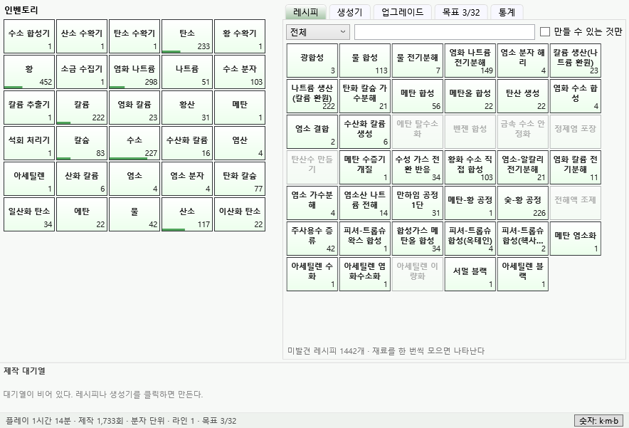

# Uranus

Uranus is a project that describe an artificial production model under the concept of "Everything can be created." and even create something does not exist in the world.

현실 세계와 최대한 같은 물질·반응·수량으로 **무엇이든 만들 수 있는 생산 모델**이다. 원자에서 출발해 분자 → 생체 분자 → 전자 부품 → 생명체로 올라가고, 끝에는 세상에 없는 것까지 만든다.

- **현실성은 데이터가 맡는다**: 실제 화학식·반응식·수량을 쓴다(8인치 웨이퍼 = 규소 1.133×10²⁴개). 원자 보존과 질량은 검증기가 확인한다.
- **단순함은 규칙이 맡는다**: 팩토리오처럼 재료가 있으면 레시피대로 만든다. 온도·압력 같은 물리 시뮬레이션은 하지 않는다.

**MachineFree**는 이 모델을 플레이하는 방치형 제작 게임이다.



## 구성

| 경로 | 내용 |
|---|---|
| `data/` | 원소, 아이템, 레시피, 생성기, 게임 설정 (YAML) |
| `src/Uranus` | 지식 모델: 아이템·레시피 정의, 화학식, 레시피 그래프(도달 가능성·질량·필요 원료), 검증기 |
| `src/Uranus.Data` | YAML 로더 |
| `src/MachineFree.Core` | 게임 규칙(UI 없음): 시뮬레이션, 세이브, 오프라인 진행 |
| `src/MachineFree` | WPF 게임 (MVVM) |
| `tools/Uranus.Tools` | 데이터 검증·분석 CLI |
| `tests/` | xUnit 테스트 |
| [`docs/ROADMAP.md`](docs/ROADMAP.md) | 분석과 개발 로드맵 |

## 실행

Windows와 .NET 10 SDK가 필요하다.

```
dotnet run --project src/MachineFree
```

- 세이브: `%LOCALAPPDATA%\MachineFree\save.json`. 10초마다, 그리고 종료할 때 저장하며 이전 파일은 `.bak`으로 남는다.
- 다시 켜면 꺼져 있던 시간(최대 24시간)만큼 게임이 진행된다.
- 조작: 레시피·생성기 클릭 1개, 우클릭 5개, Shift+클릭 가능한 만큼, Ctrl+클릭 자동 반복 켜기/끄기(자동화 업그레이드 후). 대기열 칸 클릭은 전부 취소, 우클릭은 1개 취소(재료 환불).
- 통계 탭: 아이템별 보유량, 최근 1분 순변화, 생성기 생산량과 고른 아이템의 보유량 그래프(로그 눈금). 이번 실행 동안만 기록한다.

### 게임 규칙

- 재료를 먼저 내고 대기열에 넣으면 제작 시간이 지난 뒤 결과물이 나온다.
- 생성기는 보유한 대수만큼 초당 생산한다. n대째 비용은 기본 비용 × 1.15ⁿ이다(`data/game.yaml`).
- 1보다 작은 결과물은 소수로 쌓인다. 0.2개짜리 레시피는 5번 만들면 정확히 1개가 된다.
- 레시피는 재료를 모두 한 번씩 가져 본 뒤에 목록에 나타난다.
- 업그레이드
  - **생산 라인**: 대기열 앞쪽 여러 칸을 동시에 만든다.
  - **규모**: 아토몰(×6.02e5)에서 몰(×6.02e23)까지 올라간다. 결과물이 모두 입자인 화학·생물 레시피와 입자를 내는 생성기에만 배율이 붙는다. 부품은 계속 하나씩 만든다.
    생성기는 늘 가장 큰 규모로 생산하고, 레시피는 레시피 탭의 **작업 규모**에서 가진 규모 중 하나(또는 분자 단위)로 내려서 돌릴 수 있다. 큰 규모에서는 1회 재료도 그만큼 커지기 때문이다.
  - **자동화**: Ctrl+클릭한 레시피를 대기열에서 빠질 때마다 재료가 되는 만큼(최대 60초 분량) 다시 주문한다. 자리를 비운 동안에도 돈다. 그 칸을 통째로 취소하면 자동 반복도 꺼진다.
- 목표 32개: 첫 생성기부터 아스피린, PET 병, 리튬 이온 전지, 태양광 패널, 식빵, 인슐린, 자전거, 스마트폰, 자동차, 세상에 없는 것(상온 초전도선, 물질 컴파일러)까지. 달성한 시각을 기록한다.

### 콘텐츠

원소 118 · 아이템 1,547 · 레시피 1,536(생성기 건설 53 포함) · 생성기 53. 모두 시작 상태(수소 15개)에서 도달할 수 있고, 검증기 오류·경고는 0이다.

| 분야 | 레시피 | 내용 |
|---|---:|---|
| 의약 | 219 | 아스피린(콜베-슈미트), 파라세타몰, 이부프로펜(BHC), 페니실린·세팔로스포린 발효, 인슐린, 비타민 C(라이히슈타인), 정제·캡슐·수액·주사기 |
| 화학(무기) | 196 | 염소-알칼리, 솔베이, 접촉법, 오스트발트, 하버-보슈, 불화수소·브로민, 이산화 타이타늄, 희가스 |
| 전자 | 181 | CCD·MCU·DRAM·NAND·CPU 칩 공정, 저항·MLCC·LED, PCB, 스마트폰(171 g), 노트북 |
| 유기 화학 | 153 | 원유 증류·분해·개질, BTX, 에틸렌 옥사이드·글리콜, 쿠멘법 페놀, 나일론 중간체, 피셔-트롭슈 |
| 금속 | 150 | 광석 채굴·선광, 고로·전로, 스테인리스·공구강, 크롤 공정, 리튬·희토류, 땜납, 강재·전선·박 |
| 고분자 | 138 | PE·PP·PVC·PS·PET·나일론·PC·PTFE, 고무 가황, 섬유, 접착제·도료, 타이어·병·필름 |
| 생물 | 132 | 아미노산 20종, 당·지방산·비타민, 광합성·발효, RNA·리보솜·DNA·세포 |
| 기계 | 101 | 볼트·베어링·기어, 펌프·밸브, 가솔린 엔진, 자전거(12.5 kg), 승용차, 선반·지게차 |
| 식품·농업 | 76 | 밭·과수원·축산, 제분·제빵·면, 설탕·기름, 치즈·요구르트, 맥주·와인·초콜릿 |
| 에너지 | 67 | 리튬 이온(NMC·LCO) 셀·팩, 납축전지, 태양광 패널, 모터, 변압기, 연료전지 |
| 건설 | 54 | 포틀랜드 시멘트, 콘크리트, 벽돌, 판유리, 석고보드, 목재·합판 |

분야별로 `data/items/<분야>.yaml`, `data/recipes/<분야>.yaml`, `data/generators/<분야>.yaml`에 나뉘어 있다. 폭발물, 화학무기, 마약류와 그 전구체, 핵물질은 넣지 않는다.

## 데이터 편집

```yaml
# data/recipes/chemistry.yaml
- id: methane_combustion           # CH4 + 2O2 → CO2 + 2H2O
  name: { ko: 메탄 연소 }
  time: 0.4
  in:  { CH4: 1, O2: 2 }
  out: { CO2: 1, H2O: 2 }
```

- ID는 한 번 정하면 바꾸지 않는다. 화학 물질은 화학식(`H2O`), 나머지는 영문 snake_case(`wafer_8in`)를 쓴다.
- 수량은 `2`, `0.25`, `1.133e24`, `1/3` 형식으로 쓴다.
- 화학식이 있는 아이템끼리의 반응은 원자 수가 맞아야 한다. 게임식 비율이면 `approximate: true`를 붙인다.
- 부품에 `expected_mass: [45g, 60g]`를 적으면 레시피로 계산한 질량과 비교한다.
- 아직 레시피가 없는 장기 목표는 `goal: true`로 표시한다.
- 세상에 없는 것은 `fictional: true`로 표시한다(레시피 탭의 "가상" 분야). 화학식이 있으면 가상이라도 원자 수를 지킨다.
- 시작 인벤토리, 생성기 비용 증가율, 오프라인 상한, 업그레이드, 목표는 `data/game.yaml`에 있다.
- 생성기는 `data/generators.yaml`과 `data/generators/*.yaml`에 쓴다. 생성기마다 아이템 `<id>`와 건설 레시피 `build_<id>`가 생긴다.
- 고분자는 반복 단위 1개를 입자 1개로 센다(폴리에틸렌 = C2H4). 합금은 원자 1개를 1로 세고 조성은 `note`에 적는다. 부품은 실제 질량만큼 재료를 쓴다(1 kg 강철 봉 ≈ 강철 1.08e25).

편집한 뒤에는 다음 명령으로 확인한다.

```
dotnet run --project tools/Uranus.Tools -- validate             # 오류가 있으면 종료 코드 1
dotnet run --project tools/Uranus.Tools -- bom wafer_8in        # 원료와 질량
dotnet run --project tools/Uranus.Tools -- tree ccd --depth 3   # 제작 트리 (Mermaid)
dotnet run --project tools/Uranus.Tools -- simulate --hours 120 # 자동 플레이로 목표·업그레이드 도달 시각 측정
```

`simulate`는 늘 같은 결과를 내는 단순한 봇이다. 다음 규모 업그레이드 → 다음 목표 순으로 재료를 거슬러 올라가 만들고(원료에서 가까운 경로부터), 끝나면 다음 목표가 왜 막혔는지 보여 준다.
사람보다 서툴므로 절대 시간보다 수치를 바꾸기 전후의 비교에 쓴다. 지금 수치로는 업그레이드 12개를 약 28시간, 목표 32개를 약 75시간에 끝낸다(`--hours 120`).

## 테스트

```
dotnet test
```

CI(GitHub Actions)는 빌드·테스트·데이터 검증을 돌린다.

## 개발용 옵션

- `MachineFree.exe --save <경로>`: 다른 세이브 파일로 실행한다.
- `MachineFree.exe --screenshot <png> [--screenshot-delay 초]`: 창을 PNG로 저장하고 종료한다.
- Debug 빌드에서 환경 변수 `MACHINEFREE_BINDING_LOG=<파일>`: WPF 바인딩 오류를 기록한다.
- 예전(v1) 세이브 변환: `dotnet run --project tools/Uranus.Tools -- import-save <예전 Save.json>`

## License

MIT
